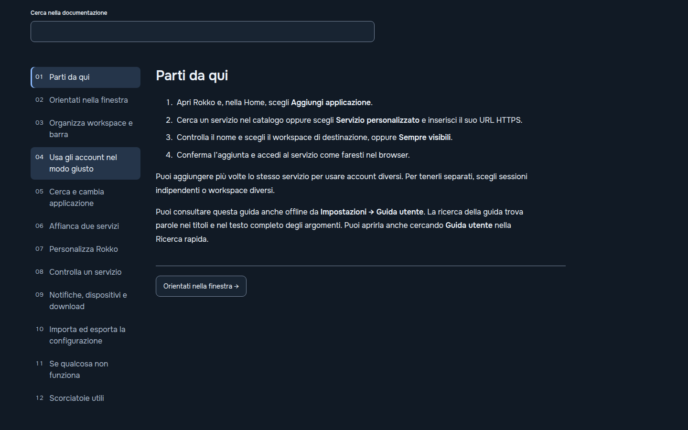

<div align="center">


# Rokko

### Le tue applicazioni web. Uno spazio tutto tuo.

Un workspace desktop open source per Linux, con servizi web, account separati e workspace personali e di lavoro.

**Sviluppato con AI · Linux first · Local first · GPL-3.0-or-later**

[Scarica Rokko](https://github.com/TatoniMatteo/rokko/releases) · [Guida utente](.github/GUIDA-UTENTE.md) · [English guide](.github/USER-GUIDE.md) · [Contribuisci](.github/CONTRIBUTING.md)

</div>

---

**Rokko è un progetto sviluppato con l’AI.** Nasce da un lavoro guidato dal suo autore,
usando agenti AI per scrivere codice, esplorare soluzioni e verificare le modifiche.
Le scelte sul prodotto e l’accettazione del risultato restano al suo autore.

Riunisci le tue applicazioni web in una finestra dedicata. Nessun account Rokko,
nessuna telemetria e nessun backend del progetto: la configurazione resta sul tuo PC.

| Organizza il tuo spazio | Usa più account | Lavora con continuità |
| :--- | :--- | :--- |
| Workspace, servizi sempre visibili e barra sui quattro lati. | Sessioni indipendenti o condivise esplicitamente nel workspace. | Ricerca rapida, due servizi affiancati e ripristino della configurazione. |



*La guida integrata nelle build di sviluppo, disponibile anche offline.*

### Cosa puoi fare

- Scegliere fra 100 servizi del catalogo o aggiungere un URL HTTPS personalizzato.
- Gestire servizi, account e workspace; importare servizi da Rambox e trasferire configurazioni fra installazioni.
- Personalizzare tema, colore, lingua italiana/inglese e icone dei servizi.
- Controllare consumi, ibernazione, download e permessi dalle impostazioni.
- Consultare la guida nel repository; le build dai sorgenti includono anche la guida offline con ricerca.

### Installa su Linux

Dalle [release](https://github.com/TatoniMatteo/rokko/releases) scegli il **DEB** della tua architettura
per Ubuntu/Debian compatibili. Il runtime è incluso; non devi installare Node o pnpm.

```sh
sudo apt install ./nome-del-pacchetto.deb
```

Per aggiornare, chiudi Rokko e installa il nuovo DEB allo stesso modo. AppImage è disponibile
come alternativa. [Installazione, aggiornamento e ambienti verificati](.github/LINUX.md).

Rokko è un’**alpha sperimentale**. I pacchetti x64 e ARM64 sono costruiti e provati in CI;
questo non garantisce ogni desktop o dispositivo. Accesso e notifiche dipendono anche dai
singoli provider; il supporto Web Push resta parziale.

### Sviluppa e contribuisci

Usa la versione Node indicata in [.node-version](.node-version) e Corepack:

```sh
corepack pnpm install --frozen-lockfile
corepack pnpm dev
```

[Ambiente e contributi](.github/CONTRIBUTING.md) · [Architettura](.github/ARCHITECTURE.md) · [Rilasci](.github/RELEASE.md)

---

<div align="center">

Realizzato con Electron, React e TypeScript.<br>
Distribuito con licenza <a href="LICENSE">GPL-3.0-or-later</a>.

</div>
